# О сайте

Блог посвящён полезным инструментам для разработки на PHP и JS.

## Об авторе

Энтузиаст Open Source, PHP-разработчик

## Связаться

<form action="https://api.web3forms.com/submit" method="POST">
    <input type="hidden" name="access_key" value="dbeb59b4-239e-43dd-a078-66b54a739f5a">
    

      <input class="md-input md-input--stretch mdx-iconsearch__input" type="text" name="name" placeholder="Ваше имя" required>
      <input class="md-input md-input--stretch mdx-iconsearch__input" type="email" name="email" placeholder="Имейл" required>
    

    

      <textarea class="md-textarea" name="message" required></textarea>
    

    <ul class="task-list">
      <li class="task-list-item">
        <label class="task-list-control">
          <input type="checkbox" required> Даю согласие на обработку имени и имейла для ответа на обращение
        </label>
      </li>
    </ul>
    <input type="checkbox" name="botcheck" class="hidden" style="display: none;">
    <input type="hidden" name="redirect" value="https://php.dragomano.ru/about">
    <button class="md-button" type="submit">Отправить</button>
</form>

## Поддержать блог

Блог бесплатный: все статьи доступны без подписки, рекламы на сайте нет. Чтобы он оставался таким, его нужно поддерживать.

Донаты идут на оплату хостинга и домена. Сайт и статьи делает один человек — без команды и без рекламодателей.

Поддержать можно через [донат на Lava.top](https://app.lava.top/dragomano?tabId=donate).

С 2020 года в блоге вышло больше 40 статей: про PHP, Docker, LEMP/WAMP, JS-фреймворки и инструменты для разработки.

Поддержка не открывает закрытых материалов: всё и так доступно. Она помогает оплатить хостинг и готовить новые статьи.

Спасибо!
