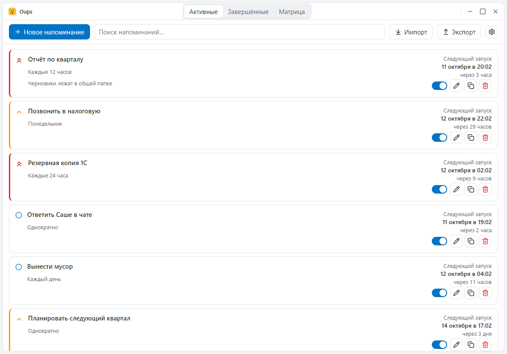
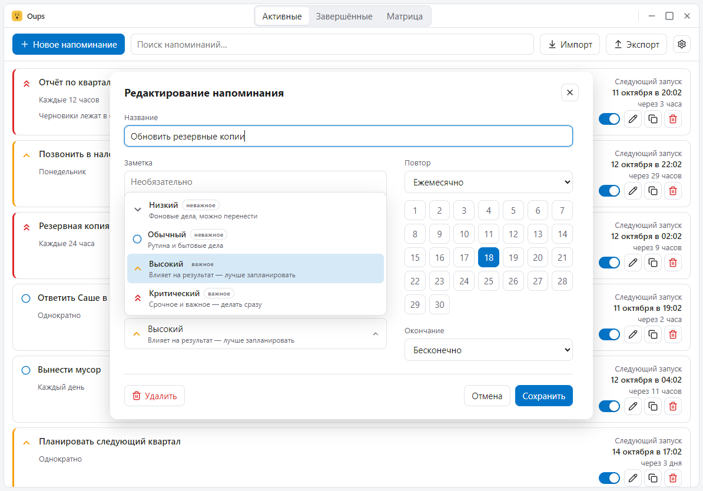
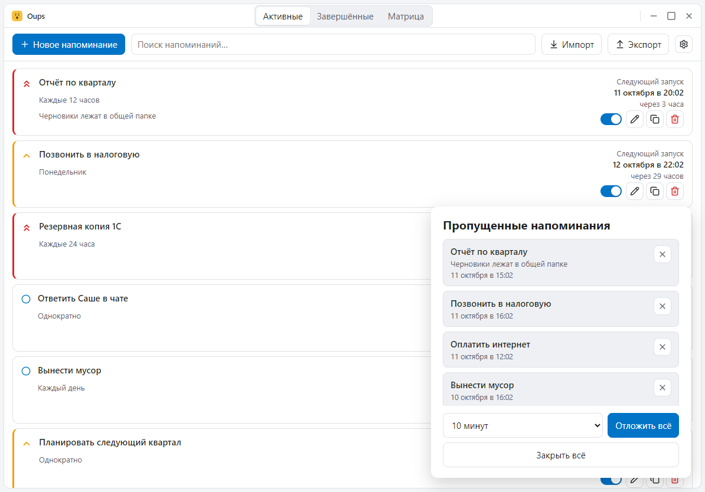
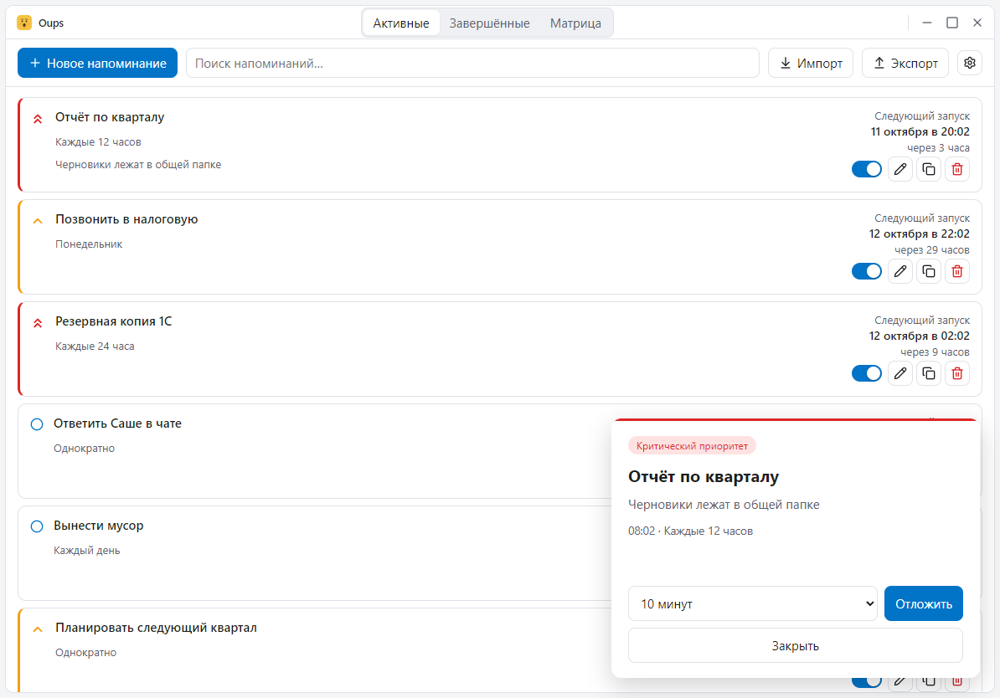
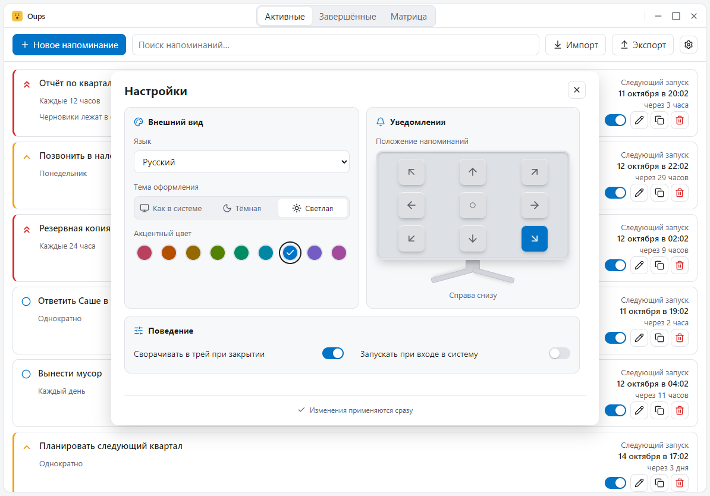
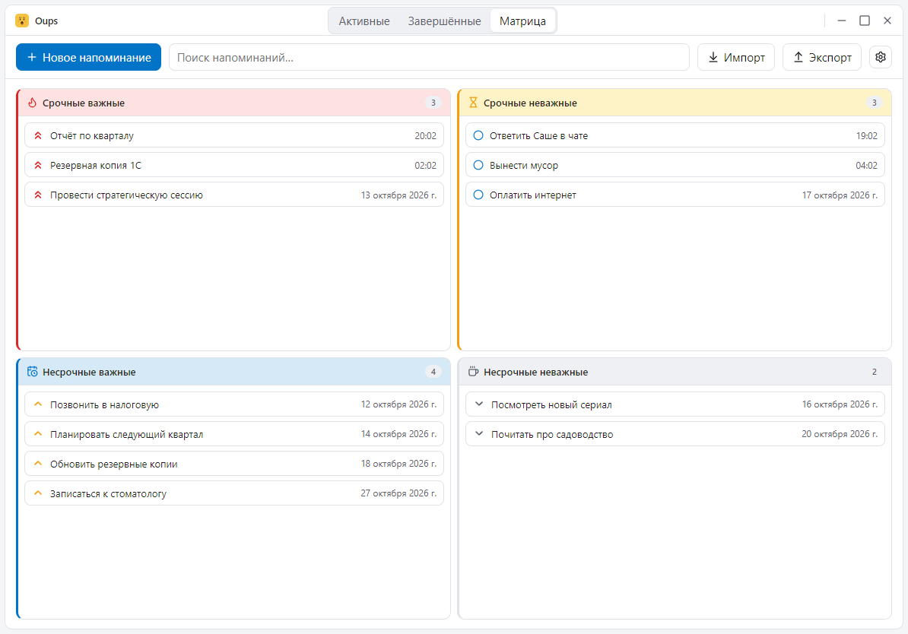

Небольшое приложение-напоминалка — отличный полигон для архитектурных вопросов: здесь есть расписание, долговременное хранилище, несколько окон, тема оформления, локализация и жёсткий бюджет размера.

<!-- more -->

В статье разбираю **Oups** — планировщик напоминаний на Tauri 2 и Svelte 5, который работает на Windows, macOS и Linux — и останавливаюсь на местах, где решение неочевидно: как три платформы делят одну кодовую базу, как считается следующее срабатывание, почему откладывание не ломает сетку повтора, как устроено безрамочное окно, зачем редактор вынесен в отдельное окно и почему под Windows база лежит рядом с исполняемым файлом.

## Что это за приложение

Oups показывает всплывающее окно в нужный момент. Напоминание бывает одноразовым — «в 15:00 в среду» — или повторяющимся, с правилом повтора и условием, когда повтор закончится. У напоминания есть название, заметка, дата и время старта и один из четырёх уровней важности. Правило повтора умеет ежедневное, по дням недели, N-го числа месяца, ежегодное и произвольный интервал в N минут, часов, дней, недель, месяцев или лет.



Плюс несколько вещей, которые обычно и определяют удобство такого планировщика:

- всплывающие окна складываются **колодой** в выбранном углу экрана, а не накрывают друг друга;
- **откладывание не ломает сетку повтора** — если было «каждые 15 минут», после откладывания на 10 минут следующее срабатывание всё равно на 15-й минуте, а не на 25-й;
- под Windows всё приложение лежит в одной папке рядом с исполняемым файлом, без установщика.

Интерфейс разложен на три представления: **Активные**, **Завершённые** и **Матрица**. Поиск ищет по названию и заметке. Напоминание можно продублировать одним кликом — откроется редактор с уже заполненными полями, готовый к сохранению как новое. Иконка в трее даёт доступ к окну, новому напоминанию, настройкам и выходу.

## Почему Tauri, а не Electron

Electron тянет с собой целый Chromium, и за это приходится платить размером архива в сотни мегабайт. Tauri использует системный WebView — WebView2 на Windows 10/11, где он уже установлен, и WebKit на macOS и Linux, — и тащит с собой только окно WebView. При этом стек остаётся привычным: фронтенд на Svelte 5 с TypeScript, бэкенд на Rust.

Бэкенд написан на Rust не ради самой моды, а потому, что расписание, клампы дат и правила окончания повтора проще выразить так, чтобы их было трудно случайно испортить. Это чистая логика без интерфейса: она проверяется обычными модульными тестами, а окно редактора физически не может её сломать. Формат времени хранится в одном месте, а не пересобирается в каждой функции заново.

Ограничение по размеру тоже зафиксировано в проекте как правило: не добавлять тяжёлые зависимости ради небольшого удобства. При этом платформа всё равно даёт то, чего на чистом вебе не бывает: нативные окна, трей, настоящая модальность и — в Windows 11 — системный материал под стеклом.

## Три платформы, три формата сборки

Приложение работает на Windows, macOS и Linux, и на каждой системе оно выглядит так, как там принято.

| Платформа | Что собирается | Как ставится |
| --- | --- | --- |
| Windows | портативная папка: бинарник, база, локали | распаковкой архива, без установщика |
| macOS | `.app` и `.dmg`, под Apple Silicon и под Intel | перетаскиванием приложения в «Программы» |
| Linux | `.deb` и `.AppImage` | установкой пакета или запуском AppImage |

Разница не в коде, а в упаковке. Базовая конфигурация Tauri описывает само окно, а платформенные надстройки добавляют только цели сборки и ресурсы:

```json
// src-tauri/tauri.linux.conf.json
{
  "bundle": {
    "active": true,
    "targets": ["deb", "appimage"],
    "resources": ["locales/"]
  }
}
```

Один нюанс, из-за которого словари пришлось положить внутрь пакета: на macOS и Linux приложение живёт в системном каталоге, куда обычному пользователю писать нельзя. Поэтому локали становятся ресурсом сборки, а база уезжает в пользовательскую папку — об этом ниже.

Релизный workflow собирает все три платформы сразу: портативный zip под Windows, `.dmg` под macOS в двух архитектурах и `.deb` с `.AppImage` под Linux. По тегу `v*` все они прикрепляются к релизу на GitHub.

А вот Windows-специфика, которая тянется через весь проект: **системный материал Mica и звук срабатывания есть только под Windows**. На macOS и Linux приложение рисует то же самое безрамочное окно, но без материала за стеклом, а звука срабатывания у него просто нет — пути к нему там не существует.

## Портативность и где живут данные

Под Windows вся модель данных лежит рядом с исполняемым файлом:

- `reminders.db` — база SQLite в режиме WAL, создаётся при первом запуске;
- `locales/*.json` — словари интерфейса;
- `oups.wav` — звук срабатывания;
- сам бинарник.

Под Windows срабатывание сопровождается щелчком. Файл `oups.wav` можно удалить — тогда напоминание будет появляться молча, — или подставить свой. Если файла нет или он нечитаем, срабатывание всё равно происходит, просто без звука. И щелчок один на тик: сколько бы напоминаний ни проснулось разом, звучит ровно один раз. На macOS и Linux звука нет вообще: проигрывание идёт через WinAPI, и на других платформах этого пути просто не существует.

В реестр приложение не пишет ничего. Единственная запись в реестр — необязательный автозапуск с Windows, и то через штатный плагин, а не своим кодом. Настройки и напоминания живут в соответствующих таблицах той же базы, а не в ветке реестра `HKCU\Software\...`.

Ограничение честное и сформулировано в документации: под Windows база должна быть в папке с правом записи. Ставить в `Program Files` нельзя — приложение работает из любой записываемой папки, это его главное свойство, а не побочный эффект.

!!! warning "Предупреждение"

    Папку с приложением нельзя открывать только для чтения, а сам бинарник нельзя запускать из `Program Files`: рядом с ним создаётся база. Это осознанный размен — переносимость важнее установки в системный каталог.

Проверка записываемости сделана пробой: приложение пытается создать служебный файл рядом с собой и по результату решает, где жить базе. Если папка с бинарником доступна для записи — база живёт рядом с ним, и это портативный режим. Если недоступна, приложение переезжает в пользовательскую папку данных: `%LOCALAPPDATA%\Oups`, `~/Library/Application Support/Oups` или `$XDG_DATA_HOME/Oups`. Именно так оно и ведёт себя на macOS и Linux, где программа стоит в системном каталоге: база физически не может лежать рядом с бинарником.

Локали ищутся в том же порядке: сначала рядом с бинарником, потом в ресурсах пакета, и только в режиме разработки — в корне проекта. Поэтому один и тот же бинарник под Windows читает словари из своей папки, а `.app` и `.deb` — из собственных ресурсов.

## Четыре окна и 29 команд

Приложение компилируется в четыре веб-страницы:

- `index.html` — главное окно со списком, вкладками и матрицей;
- `popup.html` — всплывающее напоминание и окно пропущенных;
- `editor.html` — отдельное окно редактора;
- `settings.html` — окно настроек.

Каждая страница тащит с собой ровно то, что ей нужно. Попап не знает про матрицу, а настройки — про список напоминаний.

Общение с Rust идёт через 29 команд `#[tauri::command]`: `list_reminders`, `upsert_reminder`, `snooze_reminder`, `get_popup_data`, `get_settings`, `set_settings`, `set_autostart`, `import_reminders`, `export_reminders`, `open_editor`, `window_control`, `window_backdrop` и так далее. На фронтенде они завёрнуты в типизированные обёртки в одном файле — имена команд не размазаны по компонентам.

Обновление списка устроено событием, а не опросом: после срабатывания планировщик отправляет `reminders-changed`, и один подписчик перезапрашивает список. Опроса базы из UI нет вообще. Смена настроек — отдельным событием `settings-changed`, на которое подписан трей: его меню пересобирается на новом языке.

## Безрамочное окно и системный материал

Главное окно у приложения **без системной рамки** — это правило для всех трёх платформ: в конфигурации стоят `decorations: false` и `transparent: true`. Причина практическая, а не эстетическая — за прозрачным окном Windows 11 умеет показывать свой системный материал (Mica), и приложение этим пользуется. Материал, впрочем, только Windows-овский: на macOS и Linux окно остаётся безрамочным, но за стеклом — обычный фон.

```rust
// src-tauri/src/backdrop.rs
pub fn window_backdrop(app: AppHandle, state: State<'_, AppState>) -> bool {
    apply_to_main(app.handle(), &state.settings_lock().theme)
}
```

Запрос материала у оконного менеджера возвращает честный ответ: есть Mica в этой системе или нет. Если материала нет, слои остаются плотными, и приложение выглядит как обычное окно с нарисованной рамкой. Команда `window_backdrop` вызывается **до** того, как окно показывают, — иначе первый кадр успевает мелькнуть в неправильной теме.

Само окно приложение рисует самостоятельно. Поверх материала лежат четыре слоя, и все они — переменные, а не цвета в компонентах:

- `.frame` — внешний отступ-«желоб», помеченный как зона перетаскивания и **прозрачный** в режиме Mica: материал и есть край окна;
- `.card` — скруглённая поверхность с границей, которая обрезает углы панели;
- `.content` — содержимое, помеченное как не перетаскиваемое, чтобы строки списка оставались кликабельными;
- отдельная полоса заголовка с иконкой, названием, вкладками и кнопками окна.

Под Windows системная тень, скруглённые углы и невидимая рамка изменения размера при этом сохраняются — их по-прежнему рисует сама система.

Кнопки «свернуть», «развернуть» и «закрыть» — собственные, 28×28 пикселей, и работают через команду `window_control`, а не через JS-API окна. Последнее важно: у окна нет веб-разрешений, и просить их не нужно.

Ещё одна деталь — как вычисляется размер окна при запуске. Конфигурация задаёт `1000×660` — это размер, который получает экран 1920×1080 с панелью задач. Дальше `window_size.rs` пересчитывает окно под **рабочую область монитора под курсором**, в логических пикселях, чтобы масштабирование дисплея учитывалось само:

```rust
const REFERENCE_WORK: LogicalSize<f64> = LogicalSize::new(1920.0, 1040.0);
const MAX_GROWTH: f64 = 1.5;
const EDGE: f64 = 24.0;
```

На просторном экране окно растёт, но не более чем в полтора раза — ультравайд не растягивает приложение в полосу. На тесном — ужимается, оставляя вокруг 24 пикселя рабочего стола. И есть ловушка, найденная измерением настоящего окна: tao превращает запрошенный внутренний размер в размер окна, добавляя рамку, а ещё ни разу показанное окно сообщает ту рамку, с которой было создано. Первый `set_size` поэтому попадает на ~40 пикселей ниже цели — размер выставляется повторно, пока не сойдётся, и это занимает два прохода.

## Редактор и настройки — отдельные окна

Редактор и настройки вынесены из главного окна в **собственные нативные окна**. Решение не про красоту: у окна редактора своя задача — показать форму, помещающуюся в рабочую область монитора, а не в размер основного окна, и дать ей жить поверх всего.

Оба окна создаёт общий помощник, и делают это одинаково:

```rust
// src-tauri/src/modal_window.rs
let width = 820.0_f64.min((area.size.width as f64 / scale - 32.0).max(1.0));
let height = 600.0_f64.min((area.size.height as f64 / scale - 48.0).max(1.0));
```

Дальше — владелец окна: `.owner(&main)` на Windows, `.parent(&main)` на macOS и Linux, и в обоих случаях `main.set_enabled(false)`. Модальность здесь настоящая, а не нарисованная: приложение не делает затемнение и не пишет свою анимацию — система сама блокирует родительское окно и даёт честную обратную связь. Никакого DOM-оверлея в проекте нет.

Отсюда же три практических следствия:

- **Одновременно открыто только одно модальное окно.** Повторное действие не создаёт второе окно, а фокусирует существующее.
- **Черновик у редактора один.** Открытый редактор не перетирается вторым запросом на редактирование — вместо этого фокусируется уже открытое окно.
- **Размер подгоняется по содержимому.** Редактор измеряет свою натуральную высоту и просит бэкенд вписать окно в рабочую область; настройки — то же самое.

Внутри редактора форма живёт по своим правилам: две колонки выше 700 пикселей, одна — ниже. Выбор дней месяца на узком экране прячется в нативный поповер, потому что абсолютно спозиционированная панель иначе обрезается контейнером скролла. Прокручивается только содержимое, кнопки в подвале остаются на виду.

Отдельная тонкость — прошлое время. Редактор **не блокирует** дату в прошлом: ограничение снизу есть только для новых напоминаний, потому что редактировать импортированное, потраченное или намеренно перенесённое назад напоминание должно быть можно. И любой сомнительный случай — это подсказка, а не ошибка валидации. «Одноразовое напоминание уже позади сработает сразу после сохранения», «дата окончания раньше старта значит, что следующего запуска не будет».



## Движок повторов

Это ядро проекта, и вся его логика — одна функция: **найти следующее вхождение правила после момента `after`**. Одна функция обслуживает и создание напоминания, и срабатывание, и откладывание.

Главная тонкость — откуда считается следующее вхождение. Очевидная реализация берёт «сейчас». Но если напоминание «каждые 15 минут» сработало в 09:00, а пользователь нажал «отложить на 10 минут» и увидел его в 09:10, то считать от 09:10 нельзя: сетка рассыплется, и после первого же откладывания напоминание уедет навсегда. Поэтому срабатывание передаёт в движок **момент, на который напоминание было назначено**, а не момент, когда окно показали:

```rust
fn advance_after_fire(r: &Reminder, fired_for: &str) -> Option<String> {
    let start = parse_dt(&r.start_at)?;
    let from = parse_dt(fired_for).unwrap_or_else(now_local);
    let next = next_after(start, &r.recurrence, from);
    // ... дальше применяется режим окончания
}
```

Мелочь в коде, но это ровно то место, где живёт вся нетривиальность планировщика. Поведение зафиксировано тестом: срабатывание, записанное в 09:05, всё равно даёт следующий день в 09:00, а отложенное срабатывание интервала в 09:07 даёт следующее в 09:15.

### Клампы дат

Месяцы разной длины, и это источник большинства багов в планировщиках. Напоминание «31-го числа» должно в феврале стать 28-м (или 29-м в високосный год), а «29 февраля» — не исчезать совсем: оно переезжает на 28-е в обычный год и возвращается на 29-е в следующий високосный.

Длина месяца считается по полному григорианскому правилу — с учётом того, что 1900 год не был високосным, а 2000 был:

```rust
if year % 4 == 0 && (year % 100 != 0 || year % 400 == 0) { 29 } else { 28 }
```

### Режимы окончания

Три способа закончить повтор проверяются одной функцией сравнения, и она общая для создания и для срабатывания — иначе правило вело бы себя по-разному при импорте и при обычной работе:

- **никогда** — следующее вхождение всегда есть;
- **после N срабатываний** — счётчик `fired_count` уже израсходован, значит следующего нет;
- **до даты** — сравнение только по календарной дате, **включительно**: срабатывание в 23:30 в последний день попадает внутрь диапазона.

Если правило исчерпано, у напоминания обнуляется `next_due`, но оно **не помечается завершённым** и остаётся включённым. Это разные вещи: «всё, напоминаний больше нет» и «пользователь закрыл задачу вручную».

### Интервалы за O(1)

Для фиксированных единиц (минуты, часы, дни, недели) следующая точка считается делением, а не перебором:

```rust
let elapsed = (after - start).num_seconds();
let k = elapsed.div_euclid(secs) + 1;
Some(start + Duration::seconds(secs * k))
```

Казалось бы, мелочь — но это позволяет компьютеру, который спал неделю, за один шаг догнать сетку, вместо того чтобы прокручивать десятки тысяч пропущенных вхождений. Для месяцев и лет месячная арифметика делается отдельно, с клампом дня.

## Планировщик

Планировщик — обычный цикл с интервалом **10 секунд**: забрать всё, у чего `next_due` уже наступил, посчитать следующее вхождение, записать его и открыть окно.

Два решения здесь неочевидны:

**Одно окно на напоминание.** У каждого попапа своя метка окна — `reminder-<id>`. Если окно уже открыто, планировщик не создаёт второе, а просто показывает существующее. При этом повтор всё равно продвигается: повторяющееся напоминание не должно «залипать» из-за того, что пользователь не закрыл окно.

**Пропущенные при запуске.** Если компьютер выключили на три дня, при старте планировщик находит всё просроченное и складывает снимки в **одно** окно «пропущенные», где их можно отложить все разом или закрыть по одному. Отдельное окно на каждое пропущенное напоминание при старте означало бы шторм из десятков окон.



### Попапы колодой

Позиция окна считается от рабочей области монитора **под курсором** — так панель задач никогда не перекрывается. Дальше координаты переводятся в логические пиксели через `scale_factor`, потому что рабочая область монитора приходит в физических, а позиции окон — в логических пикселях.

Каждое следующее окно сдвигается на 36 пикселей внутрь экрана, поэтому стопка читается как колода карт:

```rust
// Popup geometry: inner size plus room for the native title bar.
const POPUP_W: f64 = 440.0;
const POPUP_H: f64 = 342.0;
const POPUP_MARGIN: f64 = 24.0;
const STACK_STEP: f64 = 36.0;

let k = (index % 6) as f64 * STACK_STEP;
```

!!! note "Примечание"

    Отступ 24 пикселя выбран с поправкой на невидимую рамку изменения размера окна: `GetWindowRect` включает примерно 7 пикселей, которые не видит пользователь, поэтому видимый зазор остаётся около 16 пикселей.

Девять позиций — углы, середины сторон и центр — это обычный `match` по строке из настроек, а не конфигурация. Неизвестное значение падает в ветку верхнего левого угла.



Откладывание предлагает готовые пресеты — 5, 10, 15, 30, 60 минут и сутки, — и выбор из них меняет только `next_due`: состояние напоминания и так обновлено в момент срабатывания, поэтому в базу ничего не пишется.

В отличие от главного окна, попапы **сохраняют системную рамку**. Попап пользователь хватает и закрывает системными средствами, а своя нарисованная рамка заняла бы на экране больше места, чем того стоит: окно живёт секунды.

## SQLite без миграций

Схема намеренно простая: две таблицы, `reminders` и `settings` (ключ-значение), и один составной индекс на просроченные записи.

Отдельная деталь, на которой держится вся выборка просроченного: время хранится **строкой фиксированного формата** `ГГГГ-ММ-ДДТЧЧ:ММ:СС` в локальном календарном времени. При одинаковой длине строк лексикографический порядок совпадает с хронологическим, поэтому «что уже наступило» определяется обычным сравнением строк прямо в SQL:

```sql
SELECT ... FROM reminders
WHERE enabled = 1 AND completed = 0 AND next_due IS NOT NULL AND next_due <= ?1
```

Ни зон, ни переводов в UTC, ни преобразования типов — потому что напоминание «в 9 утра» должно означать 9 утра по местному времени, а не 9 утра в Гринвиче.

Правило повтора и режим окончания лежат в базе как JSON в отдельных колонках. Схема при этом **не мигрируется**: старое представление ежемесячного повтора (`{"type":"monthly","day":N}`) конвертируется в новое (`{"days":[N]}`) прямо при чтении, а не обновлением базы. У пользователя, который обновлялся с ранних сборок, ничего не сломалось и ничего не пересоздалось.

С уровнями важности вышло так же: четыре уровня хранятся числами `-1/0/1/2`, где `0` — обычный, `1` — важный, `-1` — низкий и `2` — критический. Значение вне диапазона чтение не ломает: любое отрицательное считается низким, любое от двух и выше — критическим.

База открывается в режиме WAL с пятисекундным таймаутом на блокировку. WAL выбран не ради скорости, а ради того, чтобы запись не блокировала чтение: пока планировщик пишет следующее срабатывание, окно всё равно читает список.

## Данные, которые не протухают

Демонстрационный набор из двенадцати напоминаний лежит в репозитории как шаблон — и в нём **нет ни одной абсолютной даты**. Вместо них относительные смещения от момента импорта:

```json
{
  "title": "Позвонить в налоговую",
  "startAt": "-6d19h",
  "nextDue": "+5h",
  "createdAt": "-30d"
}
```

Грамматика предельно узкая: знак `+` или `-`, затем компоненты дней, часов и минут строго в этом порядке, каждый не более одного раза, без разделителей — `+2h`, `-6d19h`, `+1d2h3m`. Любой другой формат отвергается.

!!! tip "Совет"

    Правило повтора всегда пересчитывается при импорте, поэтому повторяющиеся напоминания пережили бы и абсолютные даты. Не пережил бы однократный: истёкшее «один раз» срабатывает на первом же тике и сразу уезжает в завершённые. Именно поэтому шаблоны демо-данных хранят смещения.

Порядок операций в импорте тоже зафиксирован: сначала относительные метки разворачиваются в абсолютные, **только потом** запись проходит санитайзер. Обратный порядок приводит к тому, что санитайзер посчитает нераспознанную метку пустой и заменит её текущим временем, а вместе с ней потеряется и смещение.

Экспорт, наоборот, всегда пишет абсолютные метки — а читатель принимает и абсолютные, и относительные.

## Импорт чужих форматов

Кроме собственного JSON, приложение читает данные **Wise Reminder** — по расширению файла определяется формат. Это редкий случай, когда разбор чужого формата становится отдельной инженерной задачей, а не «просто распарсить JSON». Тестировал на своих данных, поэтому если ваши не импортируются полностью — присылайте обезличенные файлы, отладим.

Формат 1.x — это INI-файл в кодировке **CP1251**, где заголовки напоминаний лежат в секциях, а расписание закодировано числами. Время в нём хранится как `TDateTime` из Delphi: целое число дней от 30 декабря 1899 года плюс дробная часть суток. Дробь превращается в секунды умножением на 86400, причём сам разделитель — **запятая**, а не точка, потому что формат писался с русскими региональными настройками.

Дни месяца и дни недели лежат в `REPEAT_DATA` как битовая маска байтов: байт `0x01` на позиции *i* означает «*i*-й день». Для недель перебор ограничен семью байтами и идёт от воскресенья, для месяцев — тридцатью одним.

Формат 2.x — уже JSON с именами полей в PascalCase, где повтор задаётся строкой и разворачивается в правило приложения: `Weekdays` превращаются в набор Пн–Пт, `Weekends` — в Сб–Вс, `Hourly` — в интервал в час, `Quarterly` — в три месяца, `SemiAnnually` — в шесть, `BiWeekly` — в две недели, `Custom` — в произвольный интервал с единицей измерения.

!!! note "Примечание"

    Значение `Repeat`, которого импортер не знает, ошибкой не считается: такое напоминание приходит как одноразовое, а файл импортируется целиком. Один незнакомый ключ не должен стоить пользователю всех остальных записей.

Уровня важности в Wise Reminder 2.x всего два, поэтому `High` переносится, а всё остальное становится обычным приоритетом. Зато `RepeatEnd` с датой переносится точно: дата-часть отбрасывает часовой пояс и остаётся включительной границей.

## Трей, один экземпляр и автозапуск

У приложения есть иконка в трее с локализованным меню: открыть окно, новое напоминание, настройки, выход. Меню собирается заново при смене языка — иначе оно осталось бы на прежнем.

Плагин `single-instance` стоит **первым** в списке плагинов — это не порядок стиля, а требование: повторный запуск должен просто раскрыть уже работающее окно, а не поднять вторую копию с двумя планировщиками и двумя базами.

Автозапуск добавляет запись тем способом, какой в системе принят: ключ в `HKCU\...\Run` на Windows, LaunchAgent на macOS, desktop-запись на Linux. Флаг `--autostart` везде один и тот же, и по нему приложение понимает, что стартовал не пользователь, а значит, **вообще не показывает главное окно** — оно живёт в трее, а всплывающие окна при этом по-прежнему показываются. На этот случай есть страховка: если страница так и не загрузилась, окно всё равно появится через 10 секунд. При автозапуске этого не происходит — показывать всё равно нечего.

Отдельная мелочь про переносимость: запись автозапуска хранит **путь**, а не ссылку на папку. Если папку с приложением перенесли, путь перестаёт совпадать, и приложение — запущенное из нового места — само перерегистрирует автозапуск. Поэтому после переноса достаточно один раз запустить программу из нового места.

Кнопка закрытия по умолчанию прячет окно в трей, а не завершает приложение. Это настраивается, и именно это делает трей не украшением, а частью модели: планировщик продолжает работать, пока окна не видно.

## Фронтенд: Svelte 5 и одни часы

Фронтенд разложен по компонентам честно: отдельные компоненты на список, строку, редактор, выбор повтора, выбор важности, матрицу, настройки, полосу заголовка и кнопки окна. Общая логика живёт в `src/lib` — это не стилистическое предпочтение, а условие, что её можно покрыть тестами: почти все наборы тестов фронтенда проверяют именно файлы из `lib`, а не компоненты.

Состояние — одна руна на уровне модуля: список напоминаний и флаг загрузки. Обновление приходит событием из Rust. Время «сейчас» тоже лежит в одном месте — общий тик на 30 секунд с пересинхронизацией при фокусе окна и изменении видимости. Компоненты читают этот тик и пересчитывают производные значения, но **ни один компонент не вызывает `Date.now()` напрямую**.



### Панель инструментов, которая думает сама

Панель действий не переносится по ширине окна медиазапросами. Вместо этого она **измеряет свою естественную ширину** и решает, что убрать:

```ts
export const SEARCH_MIN_WIDTH = 170;

export function chooseToolbarLayout(m: ToolbarLayoutMetrics): ToolbarLayout {
```

Что убирать и в каком порядке, решено заранее: сначала поиск уезжает на вторую строку, потом прячется надпись «Новое напоминание», потом надписи «Импорт» и «Экспорт». Сами кнопки никогда не ломаются на две части, и ряд с ними никогда не переносится целиком.

Измерение сделано на живом DOM: рядом с панелью живёт невидимый зонд с той же разметкой, а `ResizeObserver` пересчитывает раскладку при изменении размера окна, языка или шрифта. Отдельная тонкость — иконка-кнопка обязана быть фиксированным квадратом: у флекс-элемента с заданной шириной всё равно есть право сжиматься по содержимому, и зонд однажды измерил кнопку в 30 пикселей как 18 — тихо ослабив каждое решение о раскладке.

### Ссылки в заметке

Заметка остаётся обычным текстом, но внутри неё распознаются ссылки: `http://` и `https://`, адрес `mailto:` и голый хост с `www.` (он нормализуется в `https`). Всё остальное — оставлено текстом намеренно: домен без схемы превращал бы в ссылку имена файлов и сокращения.

Дальше — проверка на стороне Rust, которая разрешает только `http`, `https` и `mailto`. `file:`, `javascript:` и произвольные свои схемы закрыты: заметка — это пользовательские данные, и открывать из неё произвольные протоколы нельзя.

### Матрица Эйзенхауэра



Матрица устроена проще, чем подсказывает её название. Квадрант определяется **только важностью** — тем уровнем, который выбрал пользователь, либо тем, в который карточку перетащили мышью. Время срабатывания в выбор квадранта не входит вообще: это зафиксировано тестом, который специально проверяет, что напоминание «через пять лет» попадает в тот же квадрант, что и просроченное. Код даже объясняет это прямо: напоминание через пять лет может быть самым важным на доске.

Срочность при этом не исчезает — она работает в двух других местах. Первое: сортировка внутри квадранта, где просроченные всплывают наверх, а напоминания без даты уходят вниз. Второе: подсветка самой даты в карточке. То есть время влияет на порядок и на вид, но квадрант не меняет.

Отдельный пример того, зачем нужна одна общая функция вместо двух похожих: определение «просрочено» реализовано **одно на всё приложение** — и список, и матрица используют её, а не повторяют сравнение в двух местах.

## Тема: палитра, а не набор цветов

Девять акцентных цветов не подбирались на глаз. У всех одинаковые перцептивные светлота и насыщенность, а тона расставлены по кругу с шагом 40 градусов:

```css
--accent: oklch(0.55 0.155 250);
```


Производные оттенки — ховер, полупрозрачная подложка — считаются в CSS через `color-mix()` от акцента и текста. Компоненты не содержат ни одного собственного цвета: если цвет нужен, он берётся из переменной. Новый акцент добавляется в пяти местах сразу, и это не формальность — так палитра остаётся системной.

Тёмная тема объявлена сразу под двумя селекторами: `[data-theme="dark"]` и медиазапрос `prefers-color-scheme` с исключением явного светлого. Режим «системная» просто **удаляет** атрибут, и всё.

## Локализация, которая описывает себя сама

Языки не перечислены в коде. Каждый файл в папке `locales` сам объявляет, «чьих он будет»: код, название и направление текста.

```json
{ "meta": { "code": "ru", "name": "Русский", "dir": "ltr" } }
```

Список языков в настройках строится сканированием папки, и файл, у которого код в `meta` не совпадает с именем, просто игнорируется. В комплекте сейчас семь языков: английский, русский, украинский, немецкий, испанский, польский и арабский. Добавить язык — значит положить рядом с бинарником ещё один JSON.

Поле `dir` заодно избавляет от отдельного кода для языков с письмом справа налево: арабский файл объявляет `dir: rtl`, и всё, интерфейс разворачивается сам.

Цепочка поиска ключа устроена с запасным вариантом на каждом шаге: сначала файл выбранного языка рядом с бинарником, потом английский файл оттуда же, и только потом английский текст, вшитый в сам бинарник при сборке. Благодаря такому порядку исправленный перевод можно просто положить в папку рядом с бинарником — приложение подхватит его при следующем запуске, и собирать заново бинарник не нужно. Обратная сторона: если удалить папку `locales` целиком, интерфейс не сломается, а станет английским — но сырых ключей пользователь не увидит никогда.

При первом запуске язык подхватывается из системы: сначала пробуется полный региональный код, потом базовый язык, и только если для него есть локаль. Выбор сохраняется и больше не меняется сам.

Название продукта в словари не попадает и берётся из конфигурации приложения. Это тоже закреплено тестом: в английском словаре ключа с названием продукта быть не должно. Иначе при переименовании пришлось бы искать старое имя сразу во всех файлах локалей, а переводчики о смене и не узнали бы.

### Правила склонения лежат в файле, а не в коде

Самая интересная часть этого — числа. Все формы одного слова перечислены в строке и разделены вертикальной чертой: в русском файле это `минуту|минуты|минут` — три формы, в английском `minute|minutes` — две. Вопрос в том, какое число какую из них возьмёт — и на раннем этапе разработки ответ на него был зашит в коде отдельно для русского языка.

Сейчас этого кода нет вообще. Категорию числа даёт `Intl.PluralRules` — стандартная возможность платформы, а не зависимость: приложение уже пользуется `Intl.DateTimeFormat` и `Intl.RelativeTimeFormat` из того же семейства. Дальше файл локализации сам раскладывает категории по слотам:

```json
"meta": { "plural_forms": { "one": 0, "few": 1, "many": 2, "other": 2 } }
```

Читается это так: одна минута — слот 0, две-четыре — слот 1, всё остальное — слот 2. Ровно тем же форматом описывается арабский, у которого категорий шесть, включая двойственное число:

```json
"plural_forms": { "zero": 0, "one": 0, "two": 2, "few": 3, "many": 1, "other": 0 }
```

Род существительного — тоже данные. По-русски «каждый час», но «каждую минуту»: слово «каждый» повторяет род единицы измерения. Поэтому рядом с формами живёт второй блок, где минуты и недели помечены женским родом, остальные — мужским.

```json
"unit_genders": { "minutes": "f", "hours": "m", "days": "m", "weeks": "f", "months": "m", "years": "m" }
```

Немецкий объявляет только `one` и `other`, польский обходится без блока родов вовсе. Отдельная деталь про украинский: у него те же три категории, что и у русского, но род у единиц другой — «година» женского рода, а «тиждень» мужского. Если бы род был зашит в коде по остатку от деления, украинский файл не смог бы отличаться от русского. Здесь он отличается двумя значениями.

Движок при этом не падает ни на чём. Файл не объявил ничего — работает старая двухформенная трактовка «форма для единицы | форма для всего остального». Объявил, но пропустил категорию или указал номер за пределами списка форм — откат на неё же. Языковой код непригоден — та же запасная ветка. Новая локаль не может уронить подпись в интерфейсе.

## Тесты как часть контракта

Правило проекта простое: любая чистая логика покрыта тестами, а правка бага получает регрессионный тест. На практике тесты есть в семнадцати модулях Rust — движок повторов, планировщик, модель, база, настройки, локализация, оба импортёра, окна, размер окна, запуск, звук и команда — и в одиннадцати файлах фронтенда, где сейчас 127 тестов.

Тесты проверяют не «функция вызвалась», а поведение, которое обязано остаться неизменным: что кламп месяца даёт 28 и 29 февраля, что срабатывание в 09:05 даёт следующий день в 09:00, что отложенный интервал не съезжает с сетки, что граница даты окончания включительная, что встроенный английский словарь валиден и не содержит названия продукта, что импорт демо-набора даёт заполненные все четыре квадранта матрицы.

Отдельный набор тестов надёжнее всего показывает цену data-driven подхода: он прогоняет движок склонения на немецком, польском, арабском и украинском, сравнивает с инлайн-фикстурами и проверяет каждый поставляемый файл — что код в `meta` совпадает с именем файла, что направление текста пригодно, что слоты склонения существуют, а набор ключей и плейсхолдеров совпадает с английским.

Есть даже тест на сами демо-данные: он запрещает в файлах абсолютные даты и требует пустой идентификатор у каждой записи, чтобы повторный импорт не перетирал существующие строки.

## Бюджет размера

Релизный профиль настроен на минимальный размер:

```toml
[profile.release]
codegen-units = 1
lto = true
opt-level = "s"
panic = "abort"
strip = true
```

Скрипт сборки дополнительно сжимает готовый исполняемый файл упаковщиком UPX, если он есть в системе, и складывает в zip ровно четыре вещи: бинарник, папку локалей, лицензию и звук. Ни установщика, ни базы в архиве: база создаётся при первом запуске. Это формат для Windows — на macOS и Linux релиз собирается обычными пакетами (`.dmg`, `.deb`, `.AppImage`), и там локали кладутся внутрь пакета как ресурс, потому что рядом с бинарником в системном каталоге ничего положить нельзя.

Мелочь, но приятная: в архиве бинарник называется `Oups.exe`, хотя пакет Rust по-прежнему зовётся `scheduler`. Имя для пользователя и техническое имя для сборки разведены намеренно.

!!! note "Примечание"

    Некоторые антивирусы ругаются на бинарники, упакованные UPX. Это известный побочный эффект, а не повод отказываться от упаковки: сборка идёт без неё, если UPX не установлен.

Версия приложения при этом живёт ровно в одном месте — в `Cargo.toml`. Ни в `package.json`, ни в конфигурации сборки её нет, и скрипт дистрибуции читает её оттуда же. Мелочь, но такие дубли обычно расходятся при первом же релизе.

## Что стоит забрать из этого

Если собираете похожее, пять вещей окупаются больше всего:

1. **Считайте следующее вхождение от слота, а не от «сейчас».** Это одна строка в сигнатуре функции, и она определяет, будет ли расписание жить год или развалится после первого откладывания.
2. **Храните время строкой фиксированного формата**, если нужен запрос «что уже наступило» прямо в SQL. Ни зон, ни миграций — но это работает только при одинаковой длине строки.
3. **Проверяйте правило при создании тем же кодом, что и при срабатывании.** Иначе импортированное правило и созданное вручную будут вести себя по-разному, и это обнаружится через полгода на данных пользователя.
4. **Отдавайте модальность операционной системе.** Владелец окна плюс блокировка родительского окна дают настоящее модальное поведение бесплатно, а самодельный оверлей с затемнением и анимацией — это десятки строк кода и ни одного нового поведения.
5. **Пусть хранилище само выбирает, где ему жить.** Портативная папка рядом с бинарником — прекрасно под Windows и невозможно под macOS или Linux, где программа стоит в системном каталоге. Одна проба «а пишется ли сюда?» и запасная ветка в пользовательскую папку данных покрывают все три платформы.

Плюс общее правило, которое оказалось удобным: тестируемая логика живёт в отдельных файлах и не знает про интерфейс. В этом проекте на ней держатся и повторы, и расстановка попапов, и цвета, и раскладка панели — а всё, что касается «как это выглядит», осталось в компонентах.

## Заключение

Я долгое время пользовался Wunderlist, пока его не заменили на Microsoft To Do. Затем перешёл на Wise Reminder 1.x, пока не вышла версия 2. В какой-то момент перестал искать и решил попробовать сделать для себя.

Oups — попытка сделать напоминание таким, каким его хочется видеть: без установщика, с понятным расписанием и файлами, которые лежат рядом с программой, а не внутри неё.

Поделитесь, какими напоминалками пользуетесь, что в них раздражает, а чего не хватает.

Если приложение вам понравится, буду рад лайкам здесь или в репозитории.

[Попробовать](https://github.com/dragomano/Oups){ .md-button .md-button--primary }
