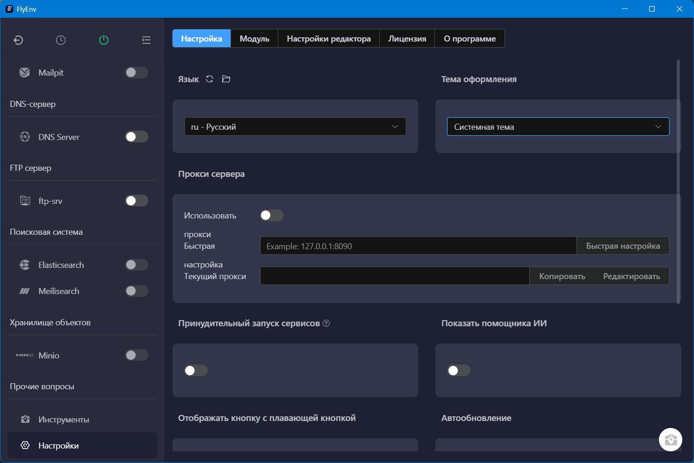
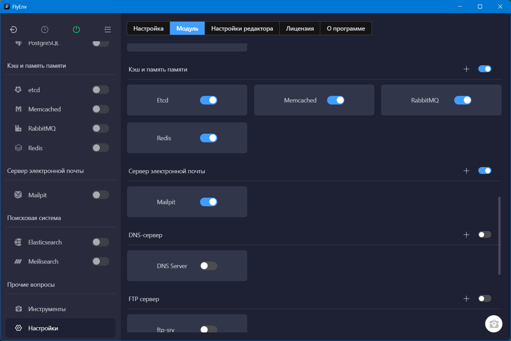
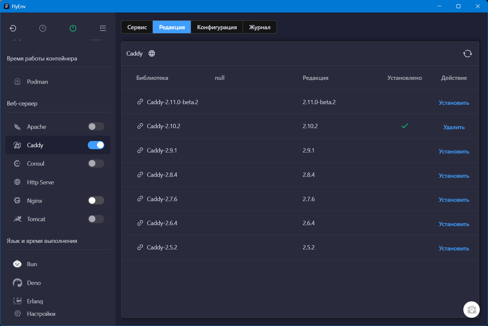
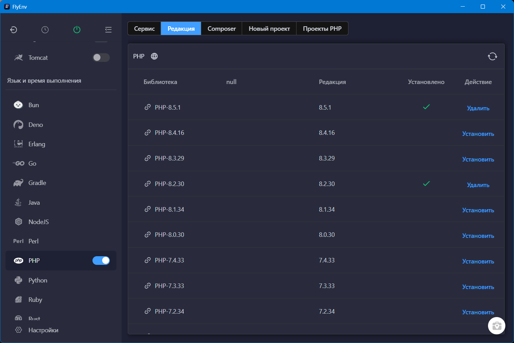
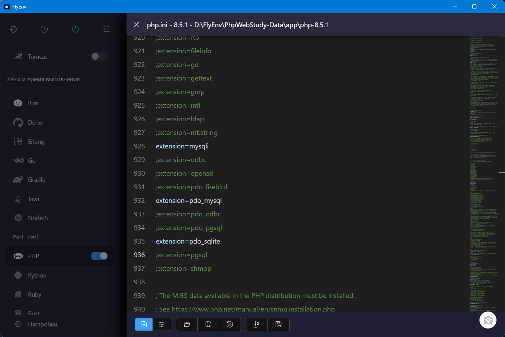
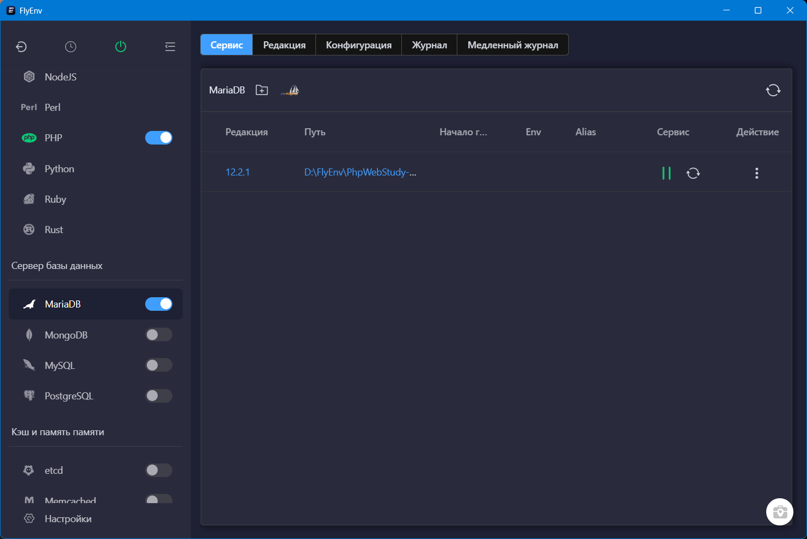
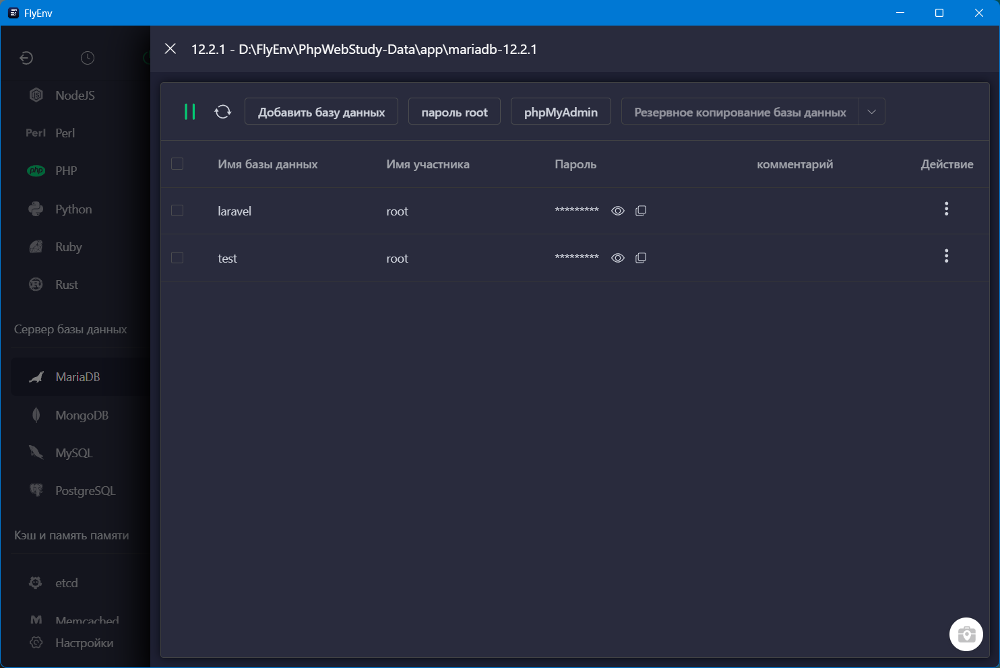
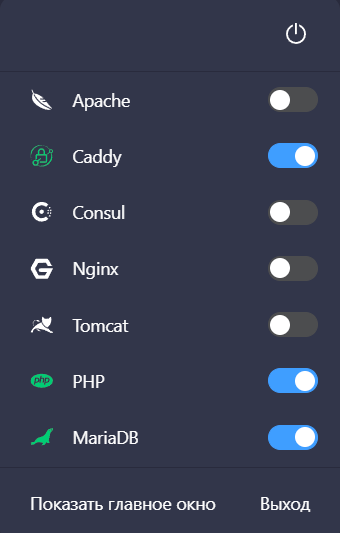
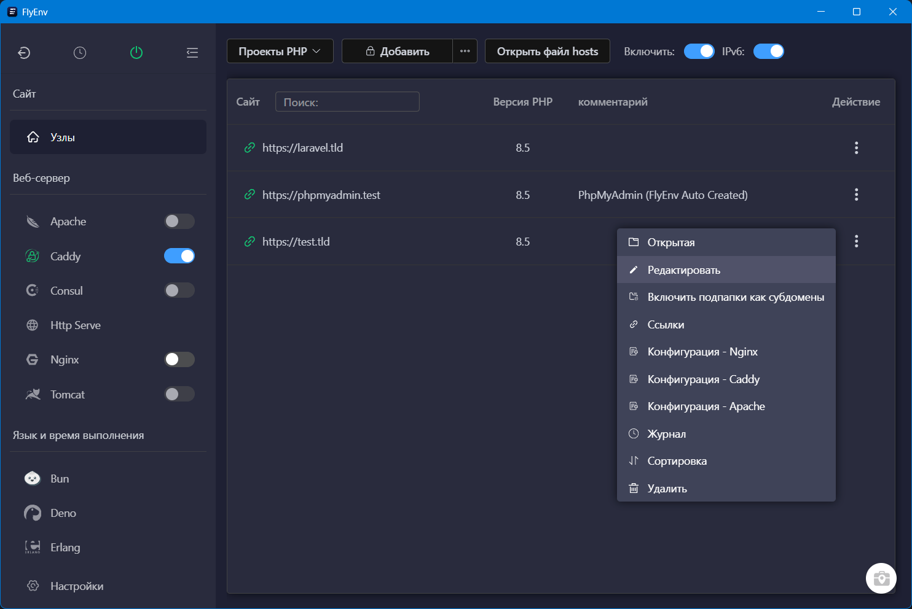

Устали при каждом обновлении скачивать монструозные дистрибутивы Open Server или возиться с настройкой Docker? Попробуйте FlyEnv — продукт, следующий девизу установки только нужных вам модулей в 1 клик.

С момента публикации материал обновлён по состоянию на октябрь 2026 (версия 4.20): у FlyEnv появились встроенный MCP-сервер для ИИ-агентов, модули популярных ИИ-инструментов, рынок плагинов и заметно поменялась модель лицензирования.

<!-- more -->

## Установка

[Скачиваем файл приложения](https://flyenv.com/download) (от 108 до 196 МБ в зависимости от платформы — установщики для Windows, macOS и Linux, плюс портативная версия), запускаем и устанавливаем. Сборки для Windows теперь подписаны цифровой подписью (SignPath Foundation), а с версии 4.20 привилегированные операции можно подтверждать стандартным UAC-запросом — без установки фонового хелпера.

## Настройка

Здесь можно выбрать язык и тему оформления, настроить автозапуск приложения и сервисов, изменить шрифты редактора и интерфейса и прочие мелочи:

При желании можно отключить ненужные вам модули, чтобы не мозолили взгляд:

## Активация модулей

Заходим в соответствующий раздел, выбираем версию, нажимаем «Установить»:

Для PHP можно быстро настроить `php.ini`, а также установить Composer:

С выбором сервера базы данных тоже проблем нет:

Даже PHPMyAdmin можно установить в 1 клик:

И конечно же, у нас есть удобная панелька в трее:

## Создание сайта

Переходим в меню Сайт => Узлы => Добавить, жмакаем на шестерёнку и выбираем нужный фреймворк.

Либо можно создать полностью пустой проект, без фреймворка, указав домен, путь к папке, версию PHP.

## Выбор версии

Бесплатная версия остаётся полнофункциональной средой: все модули из коробки, менеджеры версий, сервисы и создание сайтов — правда, максимум трёх локальных сайтов. А ИИ-помощник, утилита скриншотов и оптимизатор изображений в бесплатном режиме работают лишь первые три дня.

Платная лицензия стоит $10, покупается единоразово (без подписки) и привязывается к одному устройству: она снимает перечисленные ограничения, а сами обновления приложения остаются бесплатными. Перенести лицензию на другой компьютер можно через управление устройствами.

Получить лицензию можно тремя путями: приобрести через сервис Paddle; внести вклад в код (достаточно даже PR с правкой документации); либо написать о FlyEnv пост или обзор на любой площадке на любом языке. Лицензии выдаются вручную — после покупки или подготовки заявки остаётся указать номер заказа (или ссылку на публикацию) в настройках приложения.

## Работа с ИИ-агентами

Самое интересное из недавнего — интеграция с агентами кодирования (версия 4.16):

- **Встроенный MCP-сервер**. ИИ-клиенты получают доступ к реальному окружению: версиям PHP и Node.js, запущенным сервисам, сайтам, конфигам и логам. Сервер настраивается в интерфейсе (хост, порт, токен доступа, автозапуск), готовый конфиг для клиента генерируется автоматически, а регистрация в Claude Code, Codex, OpenCode, Kimi, Antigravity CLI и GitHub Copilot CLI выполняется в один клик. Рискованные операции можно включить только по подтверждению, и вся активность агентов пишется в журнал аудита.
- **Модули ИИ-инструментов**. Те же консольные агенты устанавливаются из FlyEnv как обычные модули — с управлением сессиями, конфигами и подключением MCP.
- **Локальные ИИ-сервисы**. Векторная база Qdrant, шлюз провайдеров CliProxyAPI и связка OpenClaw + Ollama для полностью офлайн-агентов — тоже в виде модулей.

## Плагины и новые модули

За 2026 год набор модулей заметно пополнился: S3-совместимое хранилище RustFS, графовая база Neo4j, панель pgAdmin 4 для PostgreSQL, менеджер JVM-сред SDKMAN! (Java, Kotlin, Groovy и т. д.), CliProxyAPI, Numa, r-nacos и не только.

С версии 4.19 в приложении работает и рынок плагинов (Настройки → Plugin Market): модули ставятся из официального каталога в один клик и без перезапуска, при желании можно подключить сторонние реестры. Первым плагином стал Apache Kafka. Для установки и обновления плагинов нужна лицензия — уже установленные продолжают работать и без неё.

## Сравнительная таблица

Сравним возможности бесплатной версии FlyEnv с другими известными продуктами:

| Фича \ Приложение                   | FlyEnv | Herd            | Docker | Open Server 6  |
|-------------------------------------|--------|-----------------|--------|----------------|
| Графический интерфейс               | +      | +               | +      | +              |
| Веб-сервер                          | Любой  | Nginx           | Любой  | Любой          |
| SSL без заморочек                   | +      | +               | -      | +              |
| Отдельная версия PHP для домена     | +      | +               | +      | +              |
| Установка нескольких версий Node.js | +      | +               | +      | +              |
| Работа с ИИ-агентами                | MCP    | +               | -      | -              |
| Русификация                         | +      | [патч][herd-ru] | -      | +              |
| Автообновление                      | +      | +               | -      | -              |
| Поддержка ОС                        | Все    | MacOS / Windows | Все    | Windows        |

---

[Попробовать](https://flyenv.com){ .md-button .md-button--primary }

[Документация](https://flyenv.com/guide/what-is-flyenv){ .md-button }

[herd-ru]: https://github.com/dragomano/herd-ru
